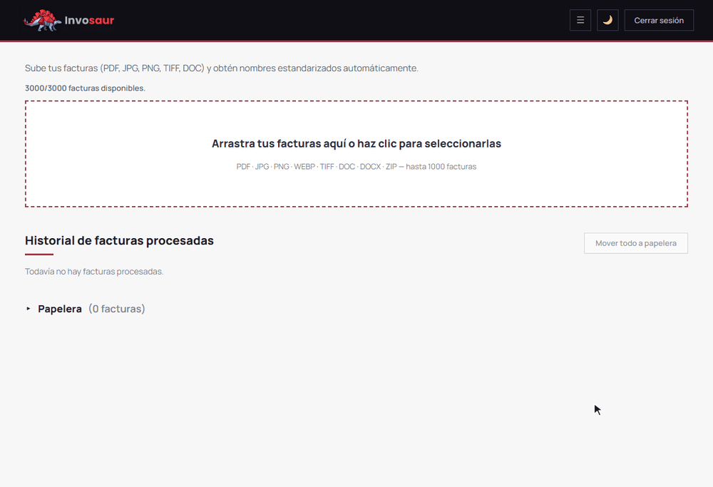
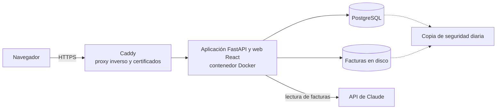

# Invosaur

Aplicación web para gestorías que lee facturas con inteligencia artificial, les pone un nombre uniforme y prepara el fichero para importarlas en el programa de contabilidad.

> **El código es privado.** Este repositorio presenta el proyecto: qué hace, cómo está montado y cómo se opera en producción.

*Demostración con facturas inventadas: se sube un ZIP con seis, la IA las lee, se corrige un nombre y se descarga el ZIP.*

## Qué hace

- Recibe facturas sueltas o en un ZIP: PDF, imágenes y Word, también escaneadas.
- La IA lee el emisor, la fecha y el número, y la app propone un nombre uniforme: `AAAAMMDD EMISOR FRA NÚMERO`, con la fecha delante para que la carpeta quede en orden cronológico y el emisor en mayúsculas y sin signos. Por ejemplo: `20260309 PAPELERÍA INVENTADA SUR SL FRA F-2026-0002.pdf`.
- Se revisa y corrige en pantalla, y se descarga todo en un ZIP.
- Módulo de contabilidad: clasifica cada factura como compra o venta y genera el fichero de importación para Glasof; las dudosas se apartan para revisarlas.
- Historial con papelera, descargas por lotes y aviso del cupo anual contratado.
- Varias empresas en la misma instalación, cada una aislada de las demás.

## En producción

En producción con una gestoría como cliente. En 2026 lleva más de 4.800 facturas procesadas, con un coste de IA de alrededor de un céntimo por factura.

## Arquitectura

- Un servidor Linux en la nube con Docker Compose.
- Caddy delante, con HTTPS automático. La aplicación solo escucha en local y el cortafuegos solo deja pasar lo imprescindible.
- La aplicación y la base de datos van en contenedores; las facturas, en un volumen.
- La copia de cada noche guarda juntas la base de datos y las facturas.
- Si la factura tiene texto, se envía el texto a la IA; si está escaneada, o el texto no basta, se envía la imagen.

## Tecnologías

| | |
|---|---|
| Servidor | Linux, Docker y Docker Compose, Caddy, cortafuegos |
| Datos | PostgreSQL, migraciones con Alembic |
| Aplicación | Python (FastAPI, asíncrono), React + TypeScript (Vite) |
| IA | API de Claude (texto y visión) |
| Pruebas | pytest, Vitest y Playwright (de extremo a extremo) |

## Cómo se opera

- Cada despliegue deja la versión anterior etiquetada: volver atrás lleva segundos.
- Antes de sustituir el contenedor en marcha, la imagen nueva se arranca en uno de usar y tirar para comprobar que la aplicación carga.
- Copia de la base de datos antes de cada migración.
- Copias de seguridad diarias y actualizaciones de seguridad automáticas.
- Dependencias de Python fijadas a versión exacta y comparadas con las de producción en cada despliegue.
- Se despliega cuando el cliente no está trabajando y sin ningún proceso a medias, con comprobaciones antes y después.
- Más de 1.800 pruebas automáticas, y pruebas de extremo a extremo con facturas sintéticas.
- Ningún dato real en el repositorio: un guardián para cualquier commit que lleve facturas, hojas de cálculo, copias de la base de datos o claves.

## Mi papel

Llevo el proyecto de principio a fin: la idea, el trato con el cliente, qué se construye y cuándo, las pruebas de aceptación, los despliegues y el servidor.

El código lo escriben agentes de IA. Trabajo con dos: uno escribe y prueba los cambios y otro revisa cada plan y cada informe antes de aplicarlo. Yo defino lo que hace falta, tomo las decisiones y doy el visto bueno a lo que llega a producción.
